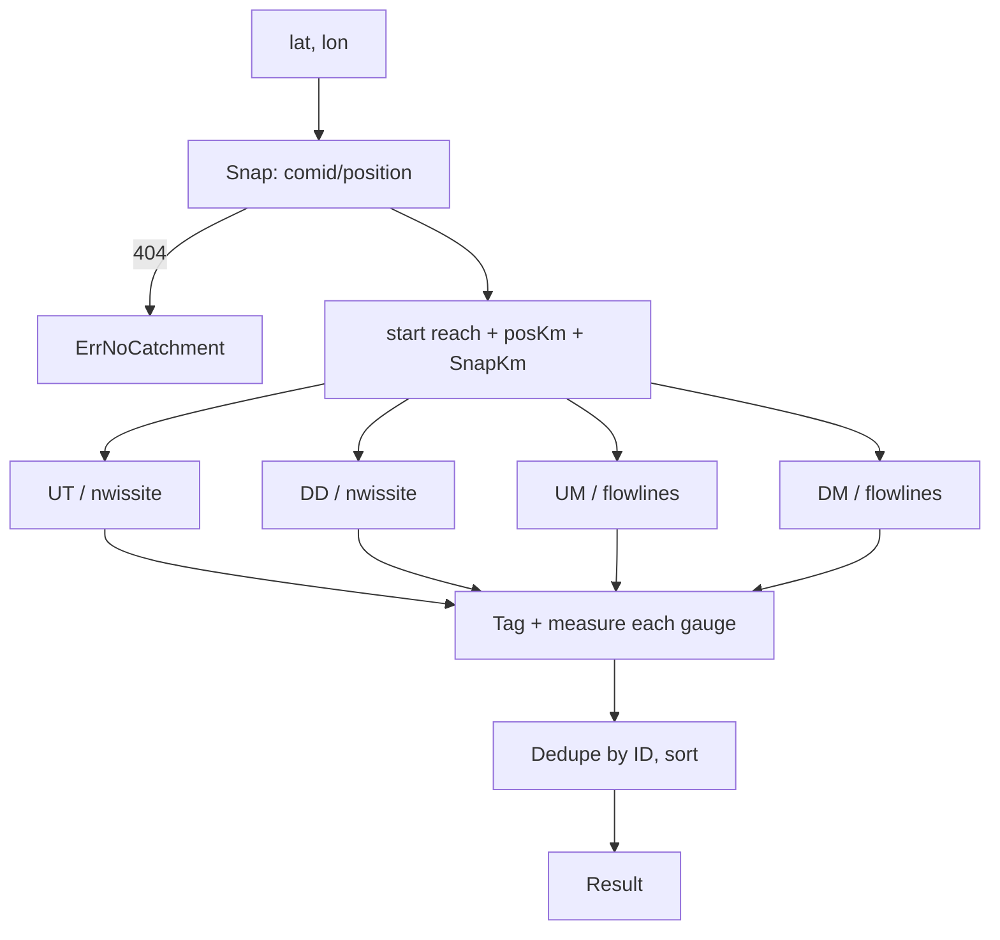
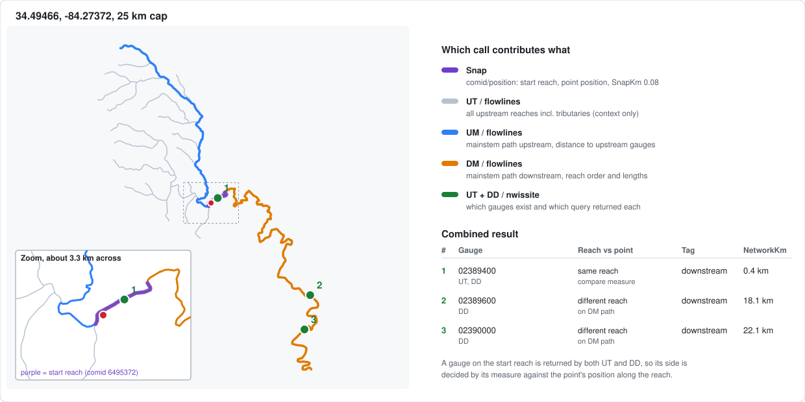

# gauges

`gauges.Find(ctx, lat, lon, km)` returns USGS stream gauges near a point, each
tagged upstream or downstream, with distance along the river.

## Why the river network

Straight-line distance ignores drainage: two gauges can be close but on
different watersheds, or on the same river far apart. So we navigate the NHDPlusV2
network via the USGS **NLDI** (Network-Linked Data Index), which is free and
keyless: `https://api.water.usgs.gov/nldi/linked-data` (moved from
`labs.waterdata.usgs.gov` in 2024).

Terms: a **flowline/reach** is one NHDPlus stream segment, identified by a
**COMID**. NLDI indexes each gauge to a reach and gives it a `measure`: percent
along the reach, **0 at the downstream end, 100 at the upstream end**.
NHDPlus flowline geometry is digitized upstream to downstream, so the first
vertex is the upstream end.

## Algorithm



1. **Snap.** `GET /comid/position?coords=POINT(lon lat)` (lon before lat)
   returns the reach containing the point, with its geometry. We project the
   point onto that geometry to get:
   - `SnapKm`: distance from the point to the stream, for sanity-checking.
   - `posKm`: distance from the reach's upstream end to the snapped point.
   A point off the network returns 404, surfaced as `ErrNoCatchment`.
2. **Find gauges.** From the COMID, navigate with `dataSource=nwissite` and a
   capped `distance`:
   - `UT` (upstream + tributaries) -> upstream gauges
   - `DD` (downstream + diversions) -> downstream gauges
3. **Get the mainstem path.** Navigate `UM` and `DM` with
   `dataSource=flowlines`. These are the ordered reaches, with geometry, used
   to measure distance.

   Steps 2 and 3 only need the COMID, so their requests run concurrently;
   the first failure cancels the rest.
4. **Tag and measure each gauge**, deduplicated by ID:
   - **Different reach, on the mainstem path.** Direction comes from which
     query returned it. `NetworkKm` = rest of the start reach (from `posKm`) +
     full length of reaches in between + offset into the gauge's reach from its
     entry end. Reach lengths are summed from geometry (haversine). The offset
     uses the gauge's `measure`; downstream travel enters a reach at its
     upstream end, upstream travel at its downstream end.
   - **Same reach as the point.** NLDI returns these in both directions, so
     the query can't tell us the side. Instead compare the gauge's position
     along the reach (from `measure`, or by projecting its coordinates if
     `measure` is missing) with `posKm`. Greater means downstream, and
     `NetworkKm` is the difference. A tie is tagged downstream.
   - **Tributary or diversion gauge.** Not on the mainstem path, so
     `NetworkKm = -1` and `Mainstem = false`. Direction still comes from the
     query. Only `StraightKm` is meaningful.
5. **Sort.** Mainstem gauges first by `NetworkKm`, then the rest by
   `StraightKm`.

### Worked example

A real run for a spot on Amicalola Creek, GA, showing the geometry each call
returns and how the results combine. The inset zooms in on the start reach.



The picture is generated by the `gauges/render` package; see
[Drawing a result](#drawing-a-result) to make one for any point.

### Geometry

Reaches run upstream to downstream. `measure` counts the other way, from the
downstream end. The point is snapped onto its reach, and `posKm` is measured
from the upstream end.

```
   upstream ------------------------------------------> downstream

   reach 11 (UM)        reach 10 (start)           reach 9 (DM)
   o===============o o=================*============o o===============o
                     ^                 ^            ^
                     first vertex      point        last vertex
                     measure 100       snapped      measure 0

                     |<---- posKm ---->|
                                       |<- Km-posKm ->|

   same-reach gauge:  gaugePos = (1 - measure/100) * Km
     gaugePos > posKm  -> downstream, NetworkKm = gaugePos - posKm
     gaugePos < posKm  -> upstream,   NetworkKm = posKm - gaugePos
```

Distance to a gauge on another mainstem reach:

```
downstream:  (Km - posKm)  +  full reaches between  +  gaugePos(in its reach)
upstream:    posKm         +  full reaches between  +  (Km - gaugePos)(in its reach)
```

Tributary gauges are not on the UM/DM path, so they get `NetworkKm = -1`:

```
            tributary gauge (UT result, not on UM path)
                  o
                  |
 ----o------------+------------*-----------o------>   mainstem
  upstream gauge           point        downstream gauge
 (NetworkKm = d)                        (NetworkKm = d)
```

Always cap `km` (default 25): unbounded `UT` on a big river returns a huge
network.

## Result fields

| Field | Meaning |
|-------|---------|
| `Result.SnapKm` | Point to snapped stream. Large means it may be on the wrong stream |
| `Gauge.Direction` | `upstream` / `downstream` relative to the point |
| `Gauge.NetworkKm` | Along-stream distance; `-1` if not measurable |
| `Gauge.StraightKm` | Great-circle distance |
| `Gauge.Mainstem` | On the mainstem path from the point |
| `Gauge.Via` | Which navigations returned it: `UT`, `DD`. Start-reach gauges show both |
| `Gauge.SiteNo` | ID without `USGS-`, for NWIS data lookups |
| `Gauge.URL` | waterdata.usgs.gov monitoring-location page |

`Result` also carries the geometry it was computed from (`Reach`, `UpPath`,
`DownPath`, and `Tributaries` when `Options.Tributaries` is set) plus the query
inputs, so a result can be drawn without more requests.

## Errors

- `ErrNoCatchment`: the point isn't on the NHDPlus network (NLDI 404).
- `*NLDIError`: an NLDI request failed. `Op` names the call (`snap`,
  `UT nwissite`, `DM flowlines`, ...), `Status` is the HTTP status (0 when no
  response arrived), and `Timeout()` reports whether it timed out, either on
  our side or as an NLDI 504. NLDI is often slow; a single call can take 20s
  or more. The default client allows 30s per request.

## Drawing a result

`gauges/render` writes a standalone SVG: the network map with numbered gauges, a
zoomed inset of the start reach (placed in the emptiest map corner), the
legend of which call contributes what, and a table of how each gauge's tag was
derived.

```go
c := gauges.NewClient(&gauges.Options{Tributaries: true}) // adds UT context
res, _ := c.Find(ctx, lat, lon, 25)
render.SVG(w, res, render.Options{Title: "Wildcat Creek"})
```

From the CLI (this regenerates the example above):

```sh
go run ./cmd/gauges -svg docs/gauges-example.svg -km 25 34.49466277273052 -84.27371698289645
```

`Options.Tributaries` costs one extra request and only affects drawing, never
which gauges are returned. The table is capped at `render.Options.MaxRows`
(default 12).

## Known limits

- **Catchment resolution.** Gauges are indexed to reaches, not exact points,
  so tags and distances within a reach are approximate (not riffle-scale).
  `measure` is assumed linear in length.
- **Coverage.** Only gauges indexed to the network appear; some won't.
- **Wrong snaps.** A point near two streams can snap to the wrong one; check
  `SnapKm`.
- **Tributary gauges** have no network distance.
- **Reported errors.** Direction and position can still be wrong in practice
  (see the site notes on letting users report bad gauge locations).

## Not yet implemented

- Fetching readings (flow `00060`, gage height `00065`, water temp `00010`),
  including filtering sentinel values like `-999999`.
- HUC-12 cross-check via the Monitoring Locations API.
- NWS weather.
