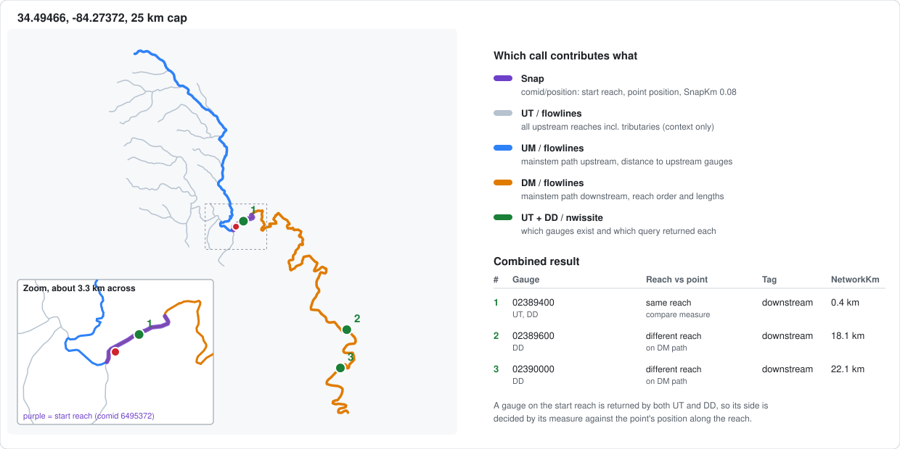

# tributary-utils

Public Go utilities for Tributary. Standard library only.

## gauges

Given a lat/long, find nearby USGS stream gauges on the same river network, each
tagged upstream or downstream of the point with the distance along the river.
It uses the USGS NLDI (free, no API key).



### Run it

```sh
go run ./cmd/gauges 34.49466 -84.27372                 # table
go run ./cmd/gauges -links 34.49466 -84.27372          # add waterdata.usgs.gov links
go run ./cmd/gauges -km 50 -json 34.49466 -84.27372    # wider cap, JSON output
go run ./cmd/gauges -svg out.svg 34.49466 -84.27372    # also draw the result
```

Arguments are `<lat> <lon>`. `-km` caps the distance searched along the river
(default 25).

### Use it

```go
c := gauges.NewClient(nil)
res, err := c.Find(ctx, 34.49466, -84.27372, 25)
for _, g := range res.Gauges {
	fmt.Println(g.Direction, g.SiteNo, g.NetworkKm, g.URL)
}
```

`c.Snap(ctx, lat, lon)` only finds the river reach the point lands on (one
request), with `SnapKm` to check it's the stream you meant.

### Docs

How it works, the algorithm, diagrams, and known limits: [docs/gauges.md](docs/gauges.md).

## readings

The latest value of every series a USGS gauge reports (flow, gage height,
water temperature, and anything else it measures), from the USGS Water Data
API. An API key is optional.

```go
c := readings.NewClient(nil)
got, err := c.Latest(ctx, []string{"01646500"}) // gauges.Gauge.SiteNo values
for _, r := range got["01646500"] {
	fmt.Println(r.Parameter, r.Value, r.Unit, r.Time, r.Discontinued)
}
```

`c.History(ctx, siteNo, parameterCode, start, end)` returns the values a gauge
reported over a time window.

Details: [docs/readings.md](docs/readings.md).

## weather

Current conditions from the National Weather Service stations nearest a
point, with each station's distance and elevation, plus the forecast for the
point. NWS is free and keyless but requires a `User-Agent` that identifies
you.

```go
c, err := weather.NewClient(&weather.Options{UserAgent: "(example.com, contact@example.com)"})
obs, err := c.Current(ctx, 34.42, -84.22) // up to 3 stations, nearest first
fc, err := c.Forecast(ctx, 34.42, -84.22) // 12-hour periods and the next 24 hours
```

Details: [docs/weather.md](docs/weather.md).

## modelflow

National Water Model streamflow for a river reach, gauged or not, from NOAA's
National Water Prediction Service. Reaches are NHDPlusV2 COMIDs, as `gauges`
returns. The values are a model estimate, not a measurement.

```go
c := modelflow.NewClient(nil) // recent estimate and 18-hour forecast by default
res, err := c.Flow(ctx, 6495864) // err only if the call couldn't be made
if err != nil {
	log.Fatal(err)
}
if run := res.Run(modelflow.ShortRange); run != nil { // nil if that series failed
	fmt.Println(run.ReferenceTime, run.Points[0].Flow, run.Unit)
}
```

`cmd/flowcheck` measures how accurate the forecasts are against gauges.
Details: [docs/modelflow.md](docs/modelflow.md), [docs/flowcheck.md](docs/flowcheck.md).

## cache

A small `Store` interface (bytes with a TTL) that `weather` and `modelflow`
cache through, with an in-memory default; pass your own to share a cache.
Details: [docs/cache.md](docs/cache.md).
